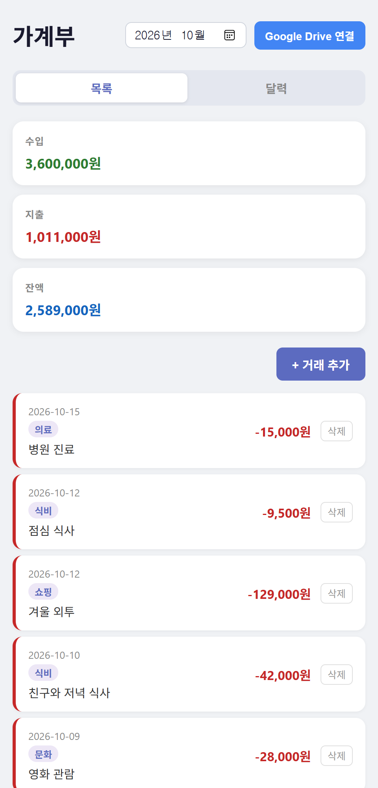
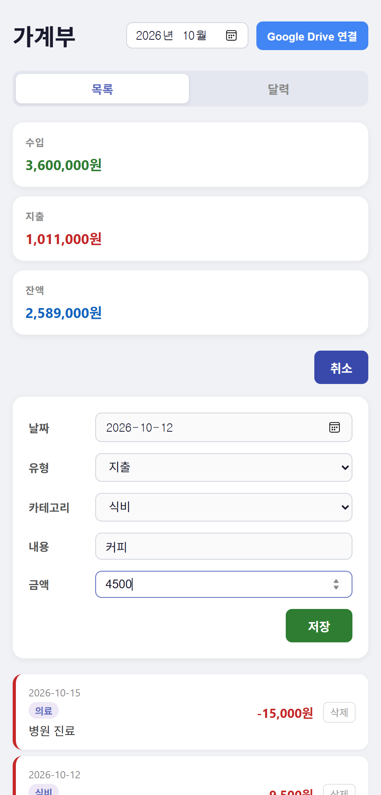
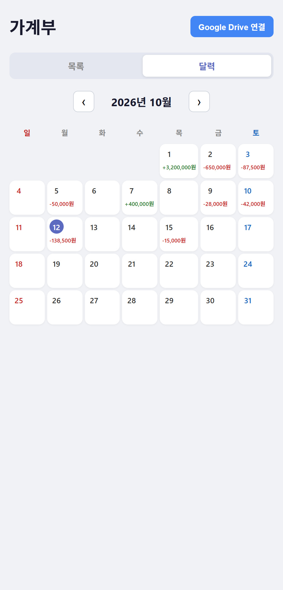
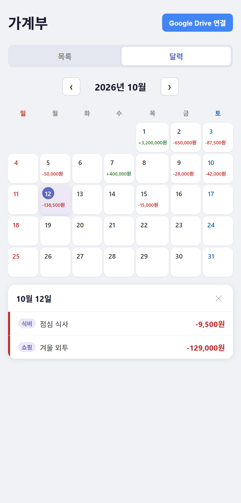

# 가계부 (Expense Tracker)

🔗 **배포 주소: [https://park-jong.github.io/expense_tracker/](https://park-jong.github.io/expense_tracker/)**

수입과 지출을 기록하고, 월별 합계와 달력으로 한눈에 확인할 수 있는 간단한 가계부 웹 앱입니다.
Google Drive에 `가계부.csv` 파일로 데이터를 저장하기 때문에 별도의 서버 없이도 어디서나 같은 내역을 확인할 수 있습니다.

## 주요 기능

- **거래 내역 관리** : 날짜, 수입/지출 유형, 카테고리, 내용, 금액을 입력해 거래를 추가/수정/삭제할 수 있습니다. 삭제 직후 약 6초간 '실행 취소'로 되돌릴 수 있습니다. 로그인하지 않아도 이 기기(localStorage)에 저장되며, 로그인하면 Drive 데이터와 자동으로 병합됩니다.
- **월별 요약** : 선택한 달의 수입 · 지출 · 잔액을 카드로 보여 줍니다.
- **달력 보기** : 날짜별 수입/지출 합계를 달력에서 확인하고, 날짜를 누르면 해당 일의 상세 내역을 볼 수 있습니다. 목록과 달력이 같은 월을 공유합니다. 좁은 화면에서는 날짜별 합계를 만·억 단위로 축약하고 전체 금액은 날짜를 눌러 상세에서 확인합니다.
- **검색·필터** : 목록에서 유형/카테고리/키워드(내용·카테고리명)로 거래를 걸러 볼 수 있습니다. 상단 요약은 필터와 무관하게 해당 월 전체 합계를 유지합니다.
- **통계** : 선택한 달의 카테고리별 지출/수입을 가로 막대로, 최근 6개월 수입·지출 추이를 세로 막대로 보여 줍니다. 막대에 마우스를 올리면(터치는 탭) 월별 추이에 수입·지출 툴팁이 나타나며, 키보드·스크린리더 사용자는 '차트를 표로 보기'(되돌아갈 때는 '차트로 돌아가기') 버튼으로 같은 숫자를 표로 확인할 수 있습니다.
- **월 예산** : 카테고리별·전체 월 예산을 정하면 통계 탭에서 사용 현황을 막대로 보고, 80% 이상이면 '주의', 초과하면 '초과'로 표시하며 목록 탭에 알림을 보여 줍니다. 로그인하면 Drive의 별도 파일 `가계부-예산.json`에 저장하고, 비로그인 상태에서는 이 기기에만 저장합니다.
- **반복 거래** : 월세·구독료처럼 매월/매주/매년 반복되는 거래를 규칙으로 등록하면 목록 탭 하단의 '반복 거래' 패널에서 관리하고, 시작일부터 오늘까지의 발생분을 자동으로 거래에 등록합니다(매월 31일은 짧은 달 말일, 매년 2/29는 평년 2/28, 미래 날짜는 만들지 않으며 오래 비운 경우 소급 등록하되 규칙당 한 번에 최대 366건). 거래·규칙 불러오기가 모두 성공한 뒤에만 등록하고, 같은 날짜·유형·카테고리·내용·금액 거래가 있으면 건너뜁니다. 규칙을 삭제해도 이미 생성된 거래는 삭제되지 않습니다. 로그인하면 Drive의 별도 파일 `가계부-반복.json`에 저장하고(거래 CSV 형식은 그대로), 비로그인 상태에서는 이 기기에만 저장합니다. 로그인 상태에서는 생성된 거래(날짜·유형·카테고리·내용·금액이 같은 거래)를 포함한 거래 저장이 Drive에서 성공한 것을 확인한 뒤에만(그 사이 사용자가 삭제·수정해 목록에서 사라진 생성 거래는 기다리지 않음) 규칙의 생성 기록(lastGenerated)을 저장하므로(저장이 동시에 여러 개 진행 중이어도 마찬가지) 거래 저장이 실패하면 규칙은 저장되지 않고 다음 성공 저장 뒤 저장되며, 불러오기 전에 끝나면 다음 불러오기 때 다시 생성됩니다(중복 검사로 중복 없음). **알려진 한계**: 거래 저장 성공 직후 규칙 저장이 실패하면, 그 사이 삭제한 생성 거래가 다음 불러오기 때 되살아날 수 있습니다. 또한 거래 저장 성공과 규칙 저장(약 0.8초 뒤) 사이에 탭을 닫으면 다음 불러오기 때 내용 중복 검사로 재생성은 막히지만, 그 사이 삭제한 생성 거래는 되살아날 수 있습니다.
- **CSV 내보내기/가져오기** : 목록 탭에서 전체 거래를 `가계부-YYYY-MM-DD.csv`(Excel용 UTF-8 BOM 포함)로 내려받고, CSV 파일을 가져와 기존 거래에 병합할 수 있습니다. id와 관계없이 날짜·유형·카테고리·설명·금액이 모두 같은 거래(기존 거래 또는 파일 안의 같은 행)는 중복으로 제외하고(같은 날 같은 금액을 일부러 두 번 기록한 거래도 합쳐질 수 있음), 중복이 아닌데 id만 겹치면 새 id를 부여하며, 형식이 잘못된 행은 건너뜁니다. 헤더 줄이 없는 CSV도 가져올 수 있습니다. 가져오기 전에 추가/중복 제외 건수를 확인창으로 안내합니다.
- **다크 모드** : 헤더의 테마 선택에서 시스템 따라가기(기본)·라이트·다크를 고를 수 있으며, 선택은 이 기기(`localStorage`의 `theme`)에 저장됩니다.
- **Google Drive 연동** : 로그인하면 Drive에 저장된 데이터를 불러오고, 변경 사항은 자동으로 저장됩니다.

## 사용 화면

> 아래 화면은 예시 데이터를 넣어 캡처한 것입니다.

### 목록 화면

월을 선택하면 해당 월의 수입 · 지출 · 잔액 요약과 거래 내역이 최신 날짜순으로 표시됩니다.



### 거래 추가

**+ 거래 추가** 버튼을 누르면 입력 폼이 열립니다. 유형(수입/지출)에 따라 선택 가능한 카테고리가 달라집니다.



| 유형 | 카테고리 |
| --- | --- |
| 수입 | 급여, 부업, 투자, 기타수입 |
| 지출 | 식비, 교통, 주거, 의료, 쇼핑, 문화, 기타지출 |

### 달력 화면

날짜별로 그날의 수입/지출 합계가 표시되며, 오늘 날짜는 강조됩니다. 좌우 화살표로 달을 이동할 수 있습니다.



### 날짜별 상세 내역

달력에서 날짜를 누르면 하단에 그날의 거래 내역이 나타납니다.



## Google Drive 연동

1. 우측 상단의 **Google Drive 연결** 버튼을 눌러 Google 계정으로 로그인합니다.
2. 처음 로그인하면 Drive 파일 접근 권한 동의 화면이 나타납니다. (`drive.file` 범위 : 이 앱이 만든 파일만 접근)
3. 로그인 후에는 Drive의 `가계부.csv`를 불러오며, 거래를 추가/수정/삭제하면 약 0.8초 뒤 자동으로 저장됩니다.
4. 저장 상태는 헤더에 `저장 중...` / `✓ 저장됨` / `⚠ 저장 실패`로 표시됩니다.

로그인 상태는 브라우저 탭(sessionStorage) 동안 유지되며, **로그아웃**을 누르면 토큰이 해제됩니다.

## 기술 스택

- React 19 (Create React App)
- Google Identity Services + Google Drive API v3
- GitHub Pages 배포

## 실행 방법

```bash
npm install
npm start
```

프로젝트 루트에 `.env` 파일을 만들고 Google OAuth 클라이언트 ID를 설정해야 Drive 연동이 동작합니다.

```
REACT_APP_GOOGLE_CLIENT_ID=your-client-id.apps.googleusercontent.com
```

### 빌드 및 배포

```bash
npm run build    # 빌드
npm run deploy   # GitHub Pages 배포 (gh-pages)
```

## 프로젝트 구조

```
src/
├── App.js                    # 앱 진입 컴포넌트 (탭, 인증, 자동 저장)
├── ListPage.js               # 목록 화면 (요약, 거래 추가/수정/삭제, 삭제 실행 취소)
├── CalendarPage.js           # 달력 화면
├── StatsPage.js              # 통계 화면 (카테고리별 가로 막대, 월별 추이, 표 보기)
├── BudgetPanel.js            # 통계 탭 월 예산 패널 (meter, 예산 설정 폼, 동기화 상태)
├── BudgetAlerts.js           # 목록 탭 예산 주의/초과 알림
├── budget.js                 # 예산 검증·병합·사용 현황 계산
├── useBudgets.js             # 예산 상태 훅 (게스트 저장, Drive 동기화)
├── guestBudgetStorage.js     # 비로그인 예산 localStorage 저장
├── RecurringPanel.js         # 목록 탭 반복 거래 접이식 패널 (규칙 목록, 추가·수정·삭제, 동기화 상태)
├── recurring.js              # 반복 규칙 검증·병합, 발생일 계산, 거래 생성·중복 방지 (순수 로직)
├── useRecurring.js           # 반복 규칙 상태 훅 (게스트 저장, Drive 동기화)
├── guestRecurringStorage.js  # 비로그인 반복 규칙 localStorage 저장
├── categories.js             # 수입/지출 카테고리 목록
├── stats.js                  # 통계 집계 함수 (카테고리별, 월별 추이, Y축 눈금)
├── googleDrive.js            # Google 로그인 및 Drive CSV 읽기/쓰기
├── csv.js                    # 거래 내역 CSV 변환 (직렬화/파싱)
├── csvTransfer.js            # CSV 내보내기 파일 생성, 가져오기 검증·중복/id 충돌 처리
├── theme.js                  # 테마(시스템/라이트/다크) 저장값 검증·저장·data-theme 적용
├── useTheme.js               # 테마 상태 훅
├── ThemeSelect.js            # 헤더 테마 선택 컨트롤
├── guestStorage.js           # 비로그인 시 localStorage 저장 및 Drive 병합 지원
├── utils.js                  # 날짜(로컬 기준) 등 공용 유틸 함수
├── csv.test.js               # csv.js 단위 테스트
├── csvTransfer.test.js       # csvTransfer.js 단위 테스트
├── theme.test.js             # 테마 함수와 전환 컨트롤 테스트
├── guestStorage.test.js      # guestStorage.js 단위 테스트
├── utils.test.js             # utils.js 월 계산 단위 테스트
├── CalendarPage.test.js      # 달력 화면 테스트
├── stats.test.js             # stats.js 단위 테스트
├── StatsPage.test.js         # 통계 화면 테스트
├── ListPage.test.js          # 목록 화면 수정/삭제 실행 취소 테스트
├── BudgetPanel.test.js       # 월 예산 패널 테스트
├── BudgetAlerts.test.js      # 예산 알림 테스트
├── budget.test.js            # budget.js 단위 테스트
├── useBudgets.test.js        # useBudgets 훅 테스트
├── guestBudgetStorage.test.js # guestBudgetStorage.js 단위 테스트
├── googleDriveBudgets.test.js # Drive 예산 파일 읽기/쓰기 테스트
├── recurring.test.js         # recurring.js 단위 테스트
├── useRecurring.test.js      # useRecurring 훅 테스트
├── RecurringPanel.test.js    # 반복 거래 패널 테스트
├── googleDriveRecurring.test.js # Drive 반복 거래 규칙 파일 읽기/쓰기 테스트
├── App.test.js               # 앱 스모크 테스트
└── App.integration.test.js   # 비로그인 저장/Drive 병합 통합 테스트
```
